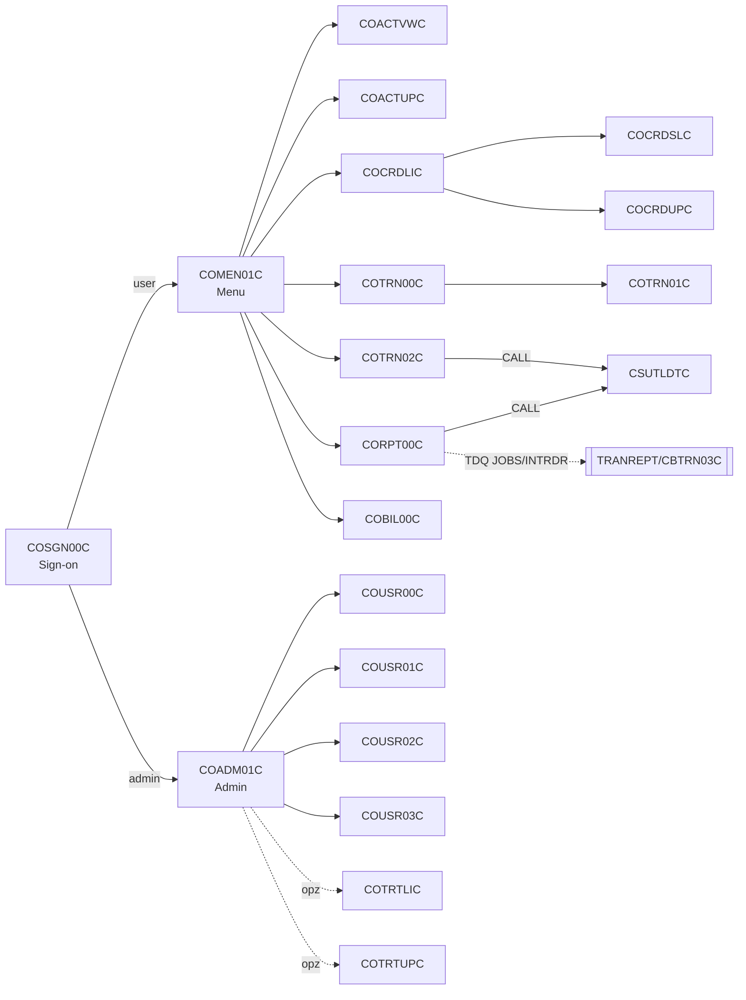
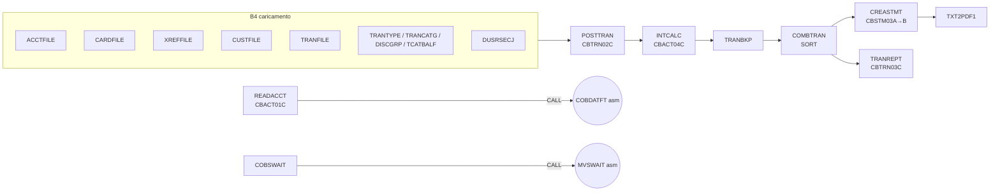
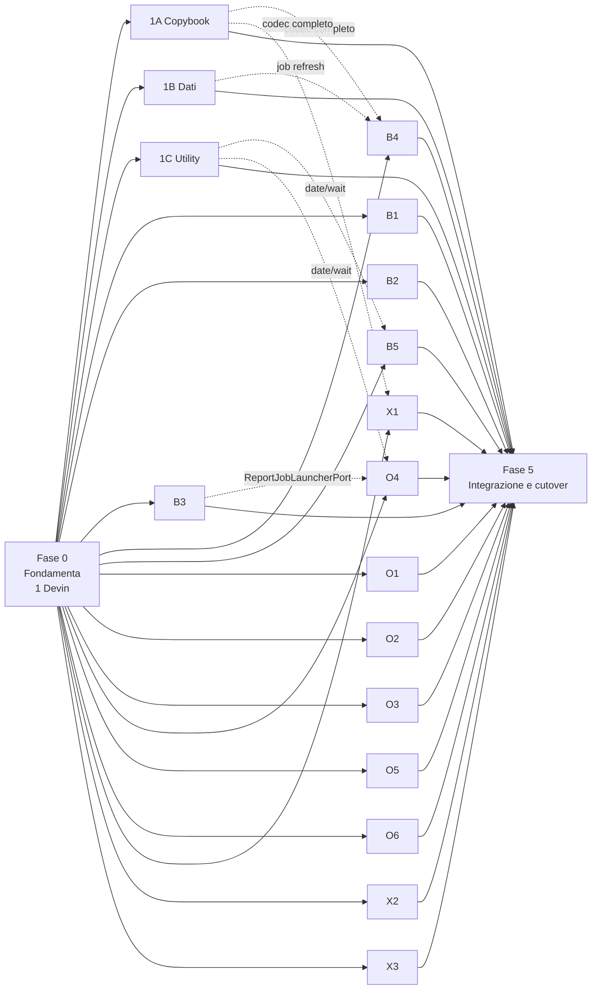

# Piano di migrazione CardDemo → Java 21

Piano a fasi per migrare CardDemo (COBOL/CICS/VSAM/JCL + estensioni IMS/DB2/MQ) verso **Java 21 + Spring Boot 3 + Spring Batch 5 + PostgreSQL**, organizzato in workstream assegnabili a **sessioni Devin parallele**.

Sequenza: **Fase 0 (bloccante, 1 Devin) → Fasi 1–4 in parallelo (17 Devin) → Fase 5 (integrazione e cutover)**.

---

## Indice

1. [Inventario del sistema sorgente](#1-inventario-del-sistema-sorgente)
2. [Dipendenze e grafo delle chiamate](#2-dipendenze-e-grafo-delle-chiamate)
3. [Architettura target](#3-architettura-target)
4. [Regole di parallelizzazione](#4-regole-di-parallelizzazione)
5. [Fase 0 — Fondamenta](#fase-0--fondamenta-1-devin-bloccante)
6. [Fase 1 — Dati e copybook](#fase-1--dati-e-copybook-3-devin-paralleli)
7. [Fase 2 — Batch JCL](#fase-2--batch-jcl-5-devin-paralleli)
8. [Fase 3 — Online CICS](#fase-3--online-cics-6-devin-paralleli)
9. [Fase 4 — Estensioni opzionali](#fase-4--estensioni-opzionali-3-devin-paralleli)
10. [Fase 5 — Integrazione, test e cutover](#fase-5--integrazione-test-e-cutover)
11. [Strategia di test di parità](#11-strategia-di-test-di-parità)
12. [Dipendenze tra fasi e calendario](#12-dipendenze-tra-fasi-e-calendario)
13. [Rischi e mitigazioni](#13-rischi-e-mitigazioni)
14. [Appendice — Template di prompt per i workstream](#14-appendice--template-di-prompt-per-i-workstream)

---

## 1. Inventario del sistema sorgente

Le tabelle sono estratte dal repo (`app/`). La Fase 0 le rigenera automaticamente in `modern/docs/inventory/` e il CI le confronta col repo.

### 1.1 Numeri chiave (app base)

| Artefatto | Quantità | Percorso |
|---|---|---|
| Programmi COBOL online (CICS) | 17 (+ `COCRDSEC`, presente in CSD ma senza sorgente) | `app/cbl/CO*.cbl` |
| Programmi COBOL batch | 13 (`CBACT01C`–`04C`, `CBCUS01C`, `CBTRN01C`–`03C`, `CBSTM03A/B`, `CBEXPORT`, `CBIMPORT`, `COBSWAIT`) | `app/cbl/CB*.cbl` |
| Subroutine COBOL | `CSUTLDTC` (validazione date via CEEDAYS) | `app/cbl/CSUTLDTC.cbl` |
| Righe COBOL totali | ~20.650 (`COACTUPC` da solo 4.236) | |
| Copybook dati/comuni | 30 | `app/cpy/` |
| Mappe BMS + copybook simbolici | 17 + 17 | `app/bms/`, `app/cpy-bms/` |
| Transazioni CICS | 18 | `app/csd/CARDDEMO.CSD` |
| JCL | 38 + 2 PROC + 1 CTL | `app/jcl/`, `app/proc/`, `app/ctl/` |
| Assembler | `MVSWAIT`, `COBDATFT` (+ macro `ASMWAIT`, `COCDATFT`) | `app/asm/`, `app/maclib/` |
| Scheduler | Control-M e CA-7 | `app/scheduler/CardDemo.controlm`, `CardDemo.ca7` |
| Dati sample | 9 file ASCII (626 record) + 13 dataset EBCDIC | `app/data/ASCII/`, `app/data/EBCDIC/` |

### 1.2 Transazioni online

| TransID | Programma | Mappa | Funzione | File VSAM | Gruppo (Fase 3) |
|---|---|---|---|---|---|
| CC00 | COSGN00C | COSGN00 | Sign-on | USRSEC | O1 |
| CM00 | COMEN01C | COMEN01 | Menu utente | – | O1 |
| CA00 | COADM01C | COADM01 | Menu admin | – | O1 |
| CAVW | COACTVWC | COACTVW | Visualizza conto | ACCTDAT, CUSTDAT, CXACAIX | O2 |
| CAUP | COACTUPC | COACTUP | Aggiorna conto/cliente | ACCTDAT, CUSTDAT, CXACAIX | O2 |
| CCLI | COCRDLIC | COCRDLI | Lista carte (paginata) | CARDDAT | O3 |
| CCDL | COCRDSLC | COCRDSL | Dettaglio carta | CARDDAT, CARDAIX | O3 |
| CCUP | COCRDUPC | COCRDUP | Aggiorna carta | CARDDAT | O3 |
| CT00 | COTRN00C | COTRN00 | Lista transazioni (paginata) | TRANSACT | O4 |
| CT01 | COTRN01C | COTRN01 | Dettaglio transazione | TRANSACT | O4 |
| CT02 | COTRN02C | COTRN02 | Nuova transazione | TRANSACT, CCXREF, CXACAIX | O4 |
| CB00 | COBIL00C | COBIL00 | Pagamento saldo | ACCTDAT, CXACAIX, TRANSACT | O4 |
| CR00 | CORPT00C | CORPT00 | Richiesta report (submit `TRANREPT` via TDQ → INTRDR) | – | O4 |
| CU00–CU03 | COUSR00C–03C | COUSR00–03 | Lista/aggiunta/modifica/cancellazione utenti | USRSEC | O5 |
| CDV1 | COCRDSEC | – | Definita in CSD, sorgente assente | – | fuori scope (da confermare) |

### 1.3 File VSAM → tabelle

Chiavi e lunghezze prese dai `DEFINE CLUSTER` in `app/jcl/`.

| Dataset | Tipo | Chiave (len off) | Rec len | AIX | Copybook | Tabella target |
|---|---|---|---|---|---|---|
| ACCTDATA | KSDS | 11 0 | 300 | – | CVACT01Y | `account` |
| CARDDATA | KSDS | 16 0 | 150 | acct-id (11 16) | CVACT02Y | `card` + idx `card_acct_id` |
| CARDXREF | KSDS | 16 0 | 50 | acct-id (11 25) | CVACT03Y | `card_xref` + idx `xref_acct_id` |
| CUSTDATA | KSDS | 9 0 | 500 | – | CVCUS01Y / CUSTREC | `customer` |
| TRANSACT | KSDS | 16 0 | 350 | proc-ts (26 304) | CVTRA05Y | `transaction` + idx `tran_proc_ts` |
| DALYTRAN | PS | – | 350 | – | CVTRA06Y | input batch (file) / `daily_transaction` (staging) |
| TCATBALF | KSDS | 17 0 | 50 | – | CVTRA01Y | `tran_cat_balance` (PK composta) |
| DISCGRP | KSDS | 16 0 | 50 | – | CVTRA02Y | `disclosure_group` (PK composta) |
| TRANTYPE | KSDS | 2 0 | 60 | – | CVTRA03Y | `transaction_type` |
| TRANCATG | KSDS | 6 0 | 60 | – | CVTRA04Y | `transaction_category` (PK composta) |
| USRSEC | KSDS | 8 0 | 80 | – | CSUSR01Y | `app_user` |
| USRSEC ESDS/RRDS | ESDS, RRDS | RBA / RRN | 80 | – | CSUSR01Y | tabelle demo `usrsec_esds` (seq id) / `usrsec_rrds` (slot) |
| EXPORT.DATA | KSDS multi-record | seq (COMP) | – | – | CVEXPORT | file di export (non tabella) |

GDG (`DEFGDGB`/`DEFGDGD`, LIMIT 5): `TRANSACT.BKUP`, `TRANSACT.DALY`, `TRANREPT`, `TCATBALF.BKUP`, `SYSTRAN`, `TRANSACT.COMBINED`, `TRANTYPE.BKUP`, `TRANCATG.PS.BKUP`, `DISCGRP.BKUP`. Diventano generazioni versionate (`<base>/G<nnnn>/`) su filesystem/S3, con retention 5 gestita da `GenerationStore`.

### 1.4 Batch JCL

| Job | Programma / utility | Funzione | Gruppo (Fase 2) |
|---|---|---|---|
| POSTTRAN | CBTRN02C | Posting transazioni giornaliere, scarti in DALYREJS | B1 |
| (nessun JCL) | CBTRN01C | Verifica/posting daily tran (variante) | B1 |
| TRANBKP | IDCAMS REPRO | Backup TRANSACT → GDG | B1 |
| COMBTRAN | SORT + IDCAMS | Merge SYSTRAN + backup → TRANSACT | B1 |
| DALYREJS, TRANIDX | IDCAMS | GDG scarti, AIX transazioni | B1 |
| INTCALC | CBACT04C | Interessi mensili, scrive SYSTRAN | B2 |
| TCATBALF, PRTCATBL | IDCAMS, SORT | Caricamento e stampa saldi per categoria | B2 |
| DISCGRP | IDCAMS | Disclosure group (tassi) | B2 |
| TRANREPT (+ `REPROC`, `TRANREPT.prc`) | SORT + CBTRN03C | Report transazioni per periodo (lanciato da CR00) | B3 |
| CREASTMT | SORT + CBSTM03A/CBSTM03B | Estratti conto testo + HTML | B3 |
| TXT2PDF1 | IKJEFT1B (REXX TXT2PDF) | Estratto conto → PDF | B3 |
| ACCTFILE, CARDFILE, XREFFILE, CUSTFILE, TRANFILE, TRANTYPE, TRANCATG, DUSRSECJ, DEFCUST, REPTFILE | IDCAMS / IEBGENER / IEFBR14 | Definizione e caricamento dei master | B4 |
| ESDSRRDS, DEFGDGB, DEFGDGD | IDCAMS | ESDS/RRDS, basi GDG | B4 |
| READACCT, READCARD, READXREF, READCUST | CBACT01C/02C/03C, CBCUS01C | Dump dei master (READACCT scrive anche PS COMP-3, array OCCURS 5, record VB) | B4 |
| CBEXPORT, CBIMPORT | CBEXPORT, CBIMPORT | Export/import multi-record (CVEXPORT: REDEFINES, COMP, COMP-3) | B4 |
| CLOSEFIL, OPENFIL | SDSF (CEMT) | Apertura/chiusura file CICS | B5 |
| WAITSTEP | COBSWAIT → MVSWAIT | Attesa temporizzata | B5 |
| INTRDRJ1, INTRDRJ2, FTPJCL | IEBGENER / INTRDR, FTP | Submit tramite internal reader, trasferimento file | B5 |
| CBADMCDJ | DFHCSDUP | Definizioni CSD | non migrato (sostituito dalla configurazione Spring) |

Flussi Control-M (`CardDemo.controlm`): **DAILY** `CLOSEFIL → TRANBKP → WAITSTEP → OPENFIL`; **WEEKLY** `MNTTRDB2 → CLOSEFIL → DISCGRP → WAITSTEP → OPENFIL` e `MNTTRDB2 → TRANEXTR`; **MONTHLY** `CLOSEFIL → INTCALC → COMBTRAN → WAITSTEP → OPENFIL`. Ciclo completo di riferimento: `scripts/run_full_batch.sh`.

### 1.5 Formati dati: cosa c'è davvero

Verificato sui sorgenti. Alcune cose sono diverse da quanto si legge in giro.

- **I master VSAM core usano zoned decimal DISPLAY** con segno overpunch (`S9(n)V99`, ultimo byte `{`, `}`, `A`–`R`, es. `00000001940{` in `acctdata.txt`), **non COMP-3**.
- **COMP/COMP-3** compaiono in `CVEXPORT.cpy`, negli output di `CBACT01C` (`ACCTDATA.PSCOMP`, `ARRYPS` con `OCCURS 5`, `VBPS` a lunghezza variabile), nelle working storage di `COBIL00C`/`COACTUPC`/`COCRDLIC`/`CBTRN03C`/`CBSTM03A` e nei moduli opzionali (`CIPAUSMY`, `CIPAUDTY`, `CSDB2RWY`).
- **REDEFINES**: CVEXPORT (6 tipi record su un'unica area), `CVCRD01Y` (viste numeriche di id), `COMEN02Y`/`COADM02Y` (tabelle menu con `OCCURS 12`), `CSDAT01Y`/`CODATECN`/`CSUTLDWY` (scomposizione date).
- **OCCURS DEPENDING ON**: compare solo come `LK-COMMAREA OCCURS 1 TO 32767 DEPENDING ON EIBCALEN` nei programmi online (COMMAREA di lunghezza variabile), non nei file dati.
- **`CUSTREC.cpy` contiene TAB**: oggi rompe il parsing in colonne fisse (GnuCOBOL segnala errori). Il codec e il golden harness devono espanderli.
- **EBCDIC**: i dataset in `app/data/EBCDIC/` sono code page **CP037** (da confermare in Fase 0 col round-trip).

---

## 2. Dipendenze e grafo delle chiamate

### 2.1 Navigazione online (XCTL via COMMAREA `COCOM01Y`)



Le opzioni dei menu sono tabelle statiche (`COMEN02Y`, `COADM02Y`). Ogni XCTL passa `CDEMO-TO-PROGRAM` e `CDEMO-FROM-*`.

### 2.2 Batch



### 2.3 Matrice copybook → consumatori

Determina chi possiede quale contratto. Un cambio a un copybook "condiviso" passa dal leader (§4.4).

| Copybook | Consumatori | Proprietario contratto |
|---|---|---|
| CVACT01Y (account) | CBACT01C, CBACT04C, CBEXPORT/IMPORT, CBSTM03A, CBTRN01C/02C, COACTUPC, COACTVWC, COBIL00C, COCRDSLC, COCRDUPC, COTRN02C | Fase 0 |
| CVACT02Y (card) | CBACT02C, CBEXPORT/IMPORT, CBTRN01C, COACTVWC, COCRD*C | Fase 0 |
| CVACT03Y (xref) | CBACT03C/04C, CBEXPORT/IMPORT, CBSTM03A, CBTRN0*C, COACT*C, COBIL00C, COCRDSLC/UPC, COTRN02C | Fase 0 |
| CVCUS01Y / CUSTREC | CBCUS01C, CBEXPORT/IMPORT, CBTRN01C, CBSTM03A, COACT*C, COCRDSLC/UPC | Fase 0 |
| CVTRA05Y (transaction) | CBACT04C, CBEXPORT/IMPORT, CBTRN0*C, COBIL00C, CORPT00C, COTRN0*C | Fase 0 |
| CVTRA01Y–04Y, 06Y, 07Y | batch B1–B3 | Fase 0 |
| CSUSR01Y | COSGN00C, COUSR0*C, e come include in quasi tutti gli online | Fase 0 |
| COCOM01Y (COMMAREA) | tutti gli online | Fase 0 (`ConversationContext`) |
| CVEXPORT | CBEXPORT, CBIMPORT | Devin 1A |
| CSDAT01Y, CODATECN, CSUTLDWY/PY | online + CBACT01C | Devin 1C |
| CSMSG01Y/02Y, COTTL01Y, CSSETATY, CSSTRPFY, CSLKPCDY | online | Fase 0 (`carddemo-online-common`) |
| COSTM01 | CBSTM03A | B3 |

---

## 3. Architettura target

### 3.1 Stack

| Livello | Scelta | Motivo |
|---|---|---|
| Linguaggio | **Java 21 LTS** (Temurin) | record, sealed interface, pattern matching `switch`, virtual thread |
| Build | **Maven multi-modulo** + Maven Wrapper | stesse convenzioni già usate su questo repo (`modern/`, `com.carddemo.<dominio>`) |
| Framework | Spring Boot 3.3.x, Spring Batch 5, Spring Security 6, Spring Data JPA, springdoc-openapi | |
| DB | PostgreSQL 16 + Flyway | target AWS RDS/Aurora PostgreSQL |
| Messaging | **Amazon SQS** (default) dietro una porta `MessageChannelPort`; Kafka come adapter alternativo | scenario AWS; request/reply con correlation id negli attributi del messaggio |
| Sicurezza | Spring Security: form/JWT per gli utenti USRSEC (BCrypt), OAuth2 Resource Server (Cognito/Keycloak) per le chiamate service-to-service | sostituisce RACF + USRSEC |
| Test | JUnit 5, AssertJ, Testcontainers (PostgreSQL, LocalStack), ArchUnit, Spring Batch Test, RestAssured | |
| Qualità | Checkstyle (Google style adattato), Spotless, JaCoCo (soglia 80% sui moduli di dominio), OWASP dependency-check | |
| CI/CD | GitHub Actions: `build` → `unit` → `parity` → `archunit` → immagine Docker | `parity` è un check obbligatorio |
| Runtime | Docker (multi-stage, Temurin 21 JRE), docker-compose in locale, ECS/EKS come target | |

### 3.2 Moduli Maven e confini di proprietà

Tutti i moduli vengono **dichiarati in Fase 0**, così nessun workstream deve toccare il POM padre.

| Modulo (`modern/…`) | Package | Proprietario |
|---|---|---|
| `carddemo-contracts` | `com.carddemo.contracts` (DTO, eventi, interfacce porta, OpenAPI) | Fase 0 (poi solo il leader) |
| `carddemo-domain` | `com.carddemo.domain` (entity JPA, repository) | Fase 0, estensioni da 1B |
| `carddemo-copybook` | `com.carddemo.copybook` (codec, record generati) | Fase 0 (base) → 1A |
| `carddemo-datamigration` | `com.carddemo.datamigration` | 1B |
| `carddemo-platform` | `com.carddemo.platform.time`, `.wait`, `.jobs`, `.files` | Fase 0 (interfacce) → 1C, B5 |
| `carddemo-batch-posting` | `com.carddemo.batch.posting` | B1 |
| `carddemo-batch-interest` | `com.carddemo.batch.interest` | B2 |
| `carddemo-batch-reports` | `com.carddemo.batch.reports` | B3 |
| `carddemo-batch-datalifecycle` | `com.carddemo.batch.datalifecycle` | B4 |
| `carddemo-batch-orchestration` | `com.carddemo.batch.orchestration` | B5 |
| `carddemo-online-common` | `com.carddemo.online.common` (ConversationContext, messaggi, PF-key) | Fase 0 |
| `carddemo-online-auth` | `com.carddemo.online.auth` (sign-on, menu, security) | O1 |
| `carddemo-online-account` | `com.carddemo.online.account` | O2 |
| `carddemo-online-card` | `com.carddemo.online.card` | O3 |
| `carddemo-online-transaction` | `com.carddemo.online.transaction` (lista, dettaglio, add, pagamento, report) | O4 |
| `carddemo-online-useradmin` | `com.carddemo.online.useradmin` | O5 |
| `modern/frontend` | SPA React + TypeScript (client generato da OpenAPI) | O6 |
| `carddemo-ext-authorization` | `com.carddemo.ext.authorization` | X1 |
| `carddemo-ext-trantype` | `com.carddemo.ext.trantype` | X2 |
| `carddemo-ext-mqinquiry` | `com.carddemo.ext.mqinquiry` | X3 |
| `carddemo-parity` | `com.carddemo.parity` (harness golden, comparatori) | Fase 0, fixture aggiunte da ogni workstream |
| `carddemo-app` | `com.carddemo.app` (Spring Boot main, wiring, profili) | Fase 0 → Fase 5 |

Regola ArchUnit (Fase 0): i moduli `batch-*`, `online-*` ed `ext-*` dipendono solo da `contracts`, `domain`, `copybook`, `platform` e `online-common`. Non dipendono mai l'uno dall'altro. Le chiamate tra domini passano dalle interfacce porta in `contracts`, per esempio `ReportJobLauncherPort` usata da O4 e implementata da B3/B5.

### 3.3 Mappatura dei costrutti mainframe

| Mainframe | Java 21 target |
|---|---|
| Programma online CICS + mappa BMS | `@RestController` (una risorsa per mappa) + `@Service` con la logica dei paragrafi; DTO request/response = campi della mappa simbolica (`app/cpy-bms/*.CPY`) |
| Pseudo-conversazione (`RETURN TRANSID COMMAREA`) | `ConversationContext` (record Java 21, specchio di `COCOM01Y`) salvato in **Spring Session JDBC**; `PGM-CONTEXT` ENTER/REENTER → stato esplicito della risposta |
| `XCTL PROGRAM(CDEMO-TO-PROGRAM)` | campo `nextScreen` nella risposta + navigazione lato client; nessuna chiamata diretta tra controller |
| Tasti PF (DFHAID) | `action` enum nella request (`ENTER`, `PF3`, `PF7`, `PF8`, …) |
| `STARTBR/READNEXT/READPREV` (paginazione) | keyset pagination sulla chiave VSAM (`WHERE key > :last ORDER BY key LIMIT n`) con chiavi prima/ultima pagina nel contesto |
| `READ UPDATE` + `REWRITE` (COACTUPC/COCRDUPC confrontano i valori vecchi) | `@Version` (optimistic locking) + confronto esplicito dei campi letti, stesso messaggio d'errore |
| VSAM KSDS / AIX | tabella con PK = chiave; AIX → indice secondario non unico |
| ESDS / RRDS | tabella con `bigserial` (ordine d'inserimento) / slot numerico |
| GDG | `GenerationStore` (directory o prefisso S3 versionati, retention configurabile) |
| JCL step `IDCAMS REPRO`/`DEFINE`/`DELETE` | step Spring Batch / migrazione Flyway / tasklet di truncate+load |
| `SORT` (DFSORT) | `ORDER BY` SQL oppure step `SortTasklet` su file (parità di collating: confronto byte EBCDIC dove serve) |
| `IEFBR14`, `IEBGENER` | tasklet di creazione/cancellazione/copia file |
| Control-M / CA-7 | `Job` Spring Batch composti in `Flow` (DAILY/WEEKLY/MONTHLY) + scheduler (Spring `@Scheduled`/Quartz in locale, EventBridge Scheduler in AWS) |
| `OPENFIL`/`CLOSEFIL` (CEMT) | flag di manutenzione (`/actuator/maintenance`) che mette le API online in sola lettura durante i job |
| TDQ → INTRDR (CORPT00C) | `ReportJobLauncherPort.launch(params)` asincrono, `JobExecution` id restituito all'utente |
| `CALL 'CEE3ABD'` | eccezione `BatchAbendException(code)` → job FAILED con exit code mappato |
| CEEDAYS (CSUTLDTC) | `java.time` + codici di esito CEE replicati |
| RACF + USRSEC | Spring Security: utenti `app_user` (BCrypt), ruoli `ADMIN`/`USER` da `SEC-USR-TYPE`; profili RACF di `samples/jcl/RACFCMDS.jcl` → scope OAuth2 |
| MQ (`MQOPEN/MQGET/MQPUT`) | `MessageChannelPort` → SQS (listener `@SqsListener`, virtual thread) |
| IMS HIDAM (DL/I `GU/GN/GNP/ISRT/REPL/DLET`) | tabelle parent/child con FK + repository con metodi equivalenti |
| DB2 embedded SQL / cursori | Spring Data JPA o jOOQ (cursori scrollabili → keyset) |
| Two-phase commit IMS+DB2 (`SYNCPOINT`) | singola transazione PostgreSQL (stesso DB); outbox se c'è messaging |

### 3.4 Regole numeriche e di formato (contratto di parità)

1. `PIC S9(n)V9(m)` (DISPLAY, COMP, COMP-3) → `BigDecimal` con `scale = m`. Mai `double`.
2. `COMPUTE` senza `ROUNDED` **tronca** (`RoundingMode.DOWN`); con `ROUNDED` usa `HALF_UP`. Ogni operazione deve dichiarare la modalità tramite `CobolMath`.
3. Il `MOVE` numerico verso un PIC più piccolo tronca le cifre alte (`CobolMath.fit(value, n, m)`). Va replicato dove i test golden lo mostrano.
4. `PIC X(n)` → `String` con padding a destra e trim solo nel DTO di presentazione. Nel DB va `VARCHAR(n)` senza trim, così la parità è byte per byte. Eccezioni documentate: password (`VARCHAR(100)` per l'hash).
5. Date/timestamp COBOL (`YYYY-MM-DD-HH.MM.SS.ffffff`) ↔ `LocalDateTime`, sempre tramite `Clock` iniettabile.
6. Collating: le chiavi sono numeriche o alfanumeriche ASCII-safe. Gli ordinamenti SORT che dipendono da EBCDIC vanno marcati nel test golden.

---

## 4. Regole di parallelizzazione

### 4.1 Principi

1. **Domini disgiunti**: ogni Devin scrive solo nel proprio modulo, nelle proprie fixture `modern/carddemo-parity/src/test/resources/golden/<ws>/` e nel proprio range Flyway. Ogni altra modifica è una **violazione di confine**, da segnalare nel messaggio finale.
2. **Contract-first**: DTO, interfacce porta, OpenAPI, schema DB baseline e `ConversationContext` vengono congelati in Fase 0 (tag `contracts-v1`).
3. **Golden test come gate comune**: nessuna PR di Fase 1–4 si mergia se `mvn -Pparity verify` non passa per il proprio workstream.
4. **Implementazioni di riferimento minime in Fase 0**: codec zoned DISPLAY per i record core, loader seed, `Clock`/date. Così Fasi 2–3 partono subito senza aspettare la Fase 1. La Fase 1 sostituisce gli interni senza cambiare le interfacce.

### 4.2 Range Flyway riservati

| Owner | Range | Owner | Range |
|---|---|---|---|
| Fase 0 (baseline + seed) | V1–V99 | O1 | V1000–V1099 |
| 1B data migration | V100–V199 | O2–O5 | V1100–V1499 (100 ciascuno) |
| B1–B5 | V200–V699 (100 ciascuno) | X1 / X2 / X3 | V2000 / V2100 / V2200 (+99) |
| Fase 5 | V9000+ | | |

### 4.3 Branching e merge

- Branch di fase: `migration/phase-0`, `migration/phase-1-4`, `migration/phase-5`. Le PR figlie puntano al branch di fase, **non a `main`**.
- Branch figli: `migration/<ws-id>` (es. `migration/1a-copybook`, `migration/o2-account`).
- Ordine di merge suggerito dentro Fasi 1–4 (per minimizzare i rebase): **1C → 1A → 1B → B4 → B1 → B2 → B3 → B5 → O1 → O2…O5 → O6 → X1–X3**.
- Il leader mergia nel branch di fase, poi `migration/phase-1-4` → `main` dopo il gate.
- Il lancio delle sessioni può riusare il launcher `migrate/launch.sh` del branch [`devin/1792404263-migrate-launcher`](https://github.com/COG-GTM/Agazzi-aws-mainframe-modernization-carddemo/tree/devin/1792404263-migrate-launcher). Va aggiornato con i workstream di questo piano: `prompts/` rigenerati dal template in §14, fasi `0 → 1-4 → 5`.

### 4.4 Protocollo di modifica dei contratti

1. Il Devin che ha bisogno di un cambio a `carddemo-contracts` o `carddemo-domain` **non lo fa da solo**: apre una issue o un commento `CONTRACT-CHANGE:` sulla PR di fase, con il diff proposto.
2. Il leader valuta l'impatto (matrice §2.3), pubblica `contracts-v1.x` e avvisa i workstream impattati.
3. Si accettano solo cambi **additivi** (nuovi campi o metodi con default). Le rotture richiedono l'approvazione dell'utente.

### 4.5 Messaggio finale obbligatorio di ogni Devin figlio

URL della PR, nome del branch, conteggio dei test (unit / parity / IT), stato del gate di parità, eventuali violazioni di confine, `CONTRACT-CHANGE` richiesti e blocker. Il leader aggrega tutto in `modern/MIGRATION_PROGRESS.md`, con una tabella aggiornata a ogni merge.

---

## Fase 0 — Fondamenta (1 Devin, bloccante)

**Obiettivo**: rendere possibile il lavoro parallelo. Alla fine di questa fase ogni workstream deve poter partire senza chiedere nulla.

### 0.1 Analisi e inventario automatico
- Script `modern/tools/inventory` (Java o Python) che rigenera le tabelle §1–§2 da `app/`:
  - programmi, con LOC e tipo (online/batch/subroutine);
  - `COPY`, `CALL`, `XCTL/LINK`, `EXEC CICS READ/WRITE/STARTBR … DATASET(...)`;
  - transazioni (CSD), mappe e campi BMS, JCL (step, `PGM=`, `DSN=`, DISP), `DEFINE CLUSTER` (chiavi, lunghezze, AIX), GDG, flussi Control-M.
- Output: `modern/docs/inventory/*.md` + `call-graph.mmd` + `inventory.json`, letto dal template dei prompt.
- Controllo di copertura: ogni programma, job e copybook di `app/` è assegnato a esattamente un workstream (`ownership.yaml`). Il CI fallisce se ne manca uno.

### 0.2 Scheletro progetto Java 21
- `modern/pom.xml` con tutti i moduli §3.2, BOM Spring Boot / Testcontainers, `maven-enforcer` (Java 21, convergenza dipendenze), Checkstyle, Spotless, JaCoCo, ArchUnit.
- `carddemo-app` avviabile (`/actuator/health`), profili `local`/`test`/`aws`, `docker-compose.yml` (PostgreSQL 16, LocalStack SQS), `Dockerfile` multi-stage.
- GitHub Actions `modern-ci.yml`: build, test, `-Pparity`, ArchUnit, report JaCoCo, build immagine.
- `modern/CONVENTIONS.md`: naming, struttura package, regole §3.4, stile dei test (`<Programma>ParityTest`, `<Paragrafo>Test`), formato dei commit e delle PR.

### 0.3 Contratti congelati (`contracts-v1`)
- **Schema DB baseline** (Flyway `V1__baseline.sql`): tutte le tabelle §1.3, con PK/indici AIX/FK logiche e `version` per l'optimistic locking.
- **Entity JPA + repository** in `carddemo-domain` per i record core.
- **DTO di dominio** (record Java 21) in `carddemo-contracts` per tutti i copybook dati (§2.3) e **DTO di schermata** per le 17 mappe BMS (campi da `app/cpy-bms/`), più `openapi.yaml` con tutti gli endpoint online (anche se non ancora implementati).
- **`ConversationContext`** (specchio di `COCOM01Y`) + `ScreenResponse<T>` (`messages`, `nextScreen`, `fieldErrors`, `context`).
- **Interfacce porta**: `RecordCodec<T>`, `GenerationStore`, `BusinessClock`, `WaitService`, `ReportJobLauncherPort`, `MessageChannelPort`, `MaintenanceModePort`, `UserCredentialService`.
- **ADR** in `modern/docs/adr/`: 001 build/stack, 002 sessione vs JWT, 003 SQS vs Kafka, 004 codec copybook (JRecord vs codegen), 005 strategia golden, 006 GDG su S3/filesystem.

### 0.4 Implementazioni di riferimento minime
- Codec **zoned DISPLAY + overpunch** per i 10 record core (lunghezze §1.3) e loader che popola il DB dai file `app/data/ASCII/*.txt` (`V2__seed_*.sql` generati, conteggi attesi: 50 account, 50 card, 50 xref, 50 customer, 7 tipi, 18 categorie, 51 disclosure group, 50 tcatbal, 10 utenti da `DUSRSECJ.jcl`).
- `BusinessClock` fisso nei test, `CobolMath` (troncamento/arrotondamento).

### 0.5 Golden harness (base della parità)
- **Batch**: compilare ed eseguire i programmi batch COBOL originali con **GnuCOBOL** sui dati sample, catturando gli output come golden master (`golden/<job>/input/`, `expected/`).
  - Fattibilità verificata in questa analisi: con `cobc -std=ibm -fsyntax-only -I app/cpy` (GnuCOBOL 3.1.2) passano **11 programmi su 14** (CBACT01C–04C, CBCUS01C, CBTRN01C–03C, CBSTM03B, CSUTLDTC, COBSWAIT).
  - Da adattare **solo nel harness**, senza toccare `app/`: `CBEXPORT`/`CBIMPORT` (`RECORD KEY` binario `COMP` su file INDEXED) e `CBSTM03A` (TAB in `CUSTREC.cpy`).
  - Stub necessari: `CEE3ABD` → exit code, `COBDATFT` → equivalente COBOL/C del formato data, `MVSWAIT` → `sleep`.
  - Script `modern/tools/golden/run-cobol.sh <job>` che riproduce lo step JCL: allocazione file, caricamento KSDS da PS, esecuzione, dump.
- **Online**: senza runtime CICS, i golden online sono **scenari di caratterizzazione** in YAML (`golden/online/<tranid>/*.yaml`): stato iniziale = seed, sequenza di input (campi mappa + tasto), atteso = campi output, messaggio (`CSMSG01Y` / literal del programma), `nextScreen`, delta sul DB. La Fase 0 definisce formato e runner (RestAssured) e scrive gli scenari di CC00 come esempio. Se è disponibile un ambiente AWS M2/UniKix (`samples/m2/`), si possono registrare sessioni 3270 reali come fonte autoritativa.
- **Comparatori** in `carddemo-parity`: record-by-record per layout copybook (diff per campo, non per byte), DB snapshot (tabella → CSV ordinato per PK), mascheramento dei campi volatili (timestamp di elaborazione) tramite `BusinessClock`.

### 0.6 Definition of Done — Fase 0
- [ ] `./mvnw verify` verde su JDK 21; `docker compose up` avvia l'app con il DB seed.
- [ ] Tutti i moduli §3.2 esistono, con smoke test; regole ArchUnit attive.
- [ ] `ownership.yaml` copre il 100% degli artefatti di `app/` (CI verde).
- [ ] Tag `contracts-v1`: schema V1, entity, DTO, OpenAPI, porte, `ConversationContext` pubblicati e documentati.
- [ ] Golden harness: almeno POSTTRAN (CBTRN02C) e INTCALC (CBACT04C) catturati e riproducibili; formato YAML online più scenari CC00 eseguibili (in rosso finché O1 non implementa).
- [ ] Prompt dei 17 workstream generati da §14 e revisionati dal leader.

---

## Fase 1 — Dati e copybook (3 Devin paralleli)

### Devin 1A — Copybook → record Java

| | |
|---|---|
| **Modulo** | `carddemo-copybook` |
| **Input** | tutti i `app/cpy/*.cpy`, `app/cpy-bms/*.CPY`, copybook dei moduli opzionali (`app/app-*/cpy/`) |
| **Lavoro** | parser copybook → AST (`cb2xml`/**JRecord** come base, oppure codegen dedicato secondo l'ADR-004; Cobrix solo se si adottano pipeline Spark). Generatore Maven (`carddemo-copybook-maven-plugin` o `exec`) che produce un `record` Java + un `RecordLayout` (offset/lunghezza/PIC) per ogni 01-level. Supporto a DISPLAY zoned con overpunch, `COMP`/`BINARY` (big-endian, 2/4/8 byte), `COMP-3`, `OCCURS n` → `List`/array a lunghezza fissa, `OCCURS DEPENDING ON` → lista con lunghezza dal campo contatore, `REDEFINES` → **`sealed interface`** con un record per vista (es. `ExportRecord permits CustomerExport, AccountExport, TransactionExport, XrefExport, CardExport`, discriminato da `EXPORT-REC-TYPE`), 88-level → `enum` o metodi booleani, record VB (RDW). EBCDIC CP037 ↔ UTF-8. |
| **Output** | `RecordCodec<T>` completo che sostituisce il codec minimo della Fase 0 senza cambiare l'interfaccia; record generati per CVEXPORT, CSUTLDWY/PY, i formati `ACCTDATA.PSCOMP`/`ARRYPS`/`VBPS` di CBACT01C e i copybook IMS/DB2. |
| **DoD** | round-trip byte-identico (decode → encode) su **ogni record** di `app/data/ASCII` e `app/data/EBCDIC` (incluso `EXPORT.DATA.PS` e `IMSDATA.DBPAUTP0.dat`); property test su COMP-3/COMP con segno e limiti; codegen deterministico (rigenerazione = zero diff). |

### Devin 1B — Schema relazionale e migrazione dati

| | |
|---|---|
| **Modulo** | `carddemo-datamigration`, Flyway V100–V199 |
| **Input** | schema V1 (Fase 0), codec (interfaccia; usa quello minimo finché 1A non mergia), dataset EBCDIC/ASCII |
| **Lavoro** | pipeline Spring Batch `vsamToRelational`: lettura PS/export VSAM (EBCDIC o ASCII), decodifica, validazione (chiavi duplicate, FK orfane xref→card/account/customer, date invalide), caricamento idempotente (upsert per PK), report di riconciliazione. Indici AIX e vincoli finali (V1xx). Tabelle ESDS/RRDS. Job inverso `relationalToVsam` (export nel formato originale) per il rollback e per i confronti di parità. Migrazione password USRSEC → BCrypt (`{bcrypt}`) come migrazione separata e reversibile in demo. |
| **Output** | `migrate-data` CLI (`java -jar … --job=vsamToRelational --source=ebcdic`), report `reconciliation.md` (conteggi, somme di controllo su `ACCT-CURR-BAL`, `TRAN-AMT`, `TRAN-CAT-BAL`, hash per colonna). |
| **DoD** | conteggi e checksum identici fra sorgente e DB per tutti i dataset; `relationalToVsam` riproduce i file ASCII **byte-identici**; riesecuzione idempotente; test Testcontainers. |

### Devin 1C — Utility Assembler e date → Java

| | |
|---|---|
| **Modulo** | `carddemo-platform` (`time`, `wait`) |
| **Input** | `app/asm/COBDATFT.asm`, `app/maclib/COCDATFT.mac`, `app/asm/MVSWAIT.asm`, `app/maclib/ASMWAIT.mac`, `app/cbl/COBSWAIT.cbl`, `app/cbl/CSUTLDTC.cbl`, `CSDAT01Y`, `CODATECN`, `CSUTLDWY/PY` |
| **Lavoro** | `CobolDateFormatter` (conversioni di formato COBDATFT, input/output type), `CeeDays` (validazione CSUTLDTC con stessi codici esito/messaggi), `WaitService` (MVSWAIT/COBSWAIT: attesa in centisecondi da `PARM`, implementata con `Thread.sleep` su virtual thread / step non bloccante in Spring Batch), `BusinessClock` di produzione (ASKTIME/FORMATTIME). |
| **DoD** | test tabellari derivati dalla logica assembler e COBOL (formati, date limite, anni bisestili, input invalidi); parità con gli output GnuCOBOL di CSUTLDTC e di CBACT01C (che chiama COBDATFT) nel golden harness. |

---

## Fase 2 — Batch JCL (5 Devin paralleli)

Regole comuni per ogni Devin batch:
- un `Job` Spring Batch per JCL, con step 1:1 rispetto agli step JCL e nome job = nome JCL;
- `JobParameters` al posto di `PARM`/`DATEPARM`;
- file in/out via `RecordCodec` e `GenerationStore`;
- abend → exit status;
- test **file-in/file-out golden** obbligatori (§11.3) e test di riavvio (restart dallo step fallito).

| Devin | Linea di business | Job / programmi | Note di parità |
|---|---|---|---|
| **B1 — Posting** | Posting giornaliero transazioni | POSTTRAN (CBTRN02C), CBTRN01C, DALYREJS, TRANBKP, COMBTRAN, TRANIDX | Validazioni CBTRN02C con gli stessi codici e testi di scarto in DALYREJS (100 `INVALID CARD NUMBER FOUND`, 101 `ACCOUNT RECORD NOT FOUND`, 102 `OVERLIMIT TRANSACTION`, 103 `TRANSACTION RECEIVED AFTER ACCT EXPIRATION`); aggiornamento `TCATBALF` e saldi account; COMBTRAN = merge ordinato SYSTRAN + backup |
| **B2 — Interessi** | Interessi e saldi per categoria | INTCALC (CBACT04C), TCATBALF, PRTCATBL, DISCGRP | Formula `(TRAN-CAT-BAL * DIS-INT-RATE) / 1200` con troncamento COBOL; fallback al gruppo `DEFAULT`; transazioni di interesse in SYSTRAN con ID generati identici (data parametro + sequenza) |
| **B3 — Report e statement** | Reportistica | TRANREPT (SORT + CBTRN03C + PROC REPROC/TRANREPT), CREASTMT (CBSTM03A/B), TXT2PDF1 | Report a 133 colonne byte-identico (intestazioni, totali per pagina/conto/generale); statement testo + HTML identici; PDF generato da testo (OpenPDF), confronto sul testo estratto. Implementa `ReportJobLauncherPort` per O4 |
| **B4 — Data lifecycle** | Caricamento, export/import, utility | ACCTFILE, CARDFILE, XREFFILE, CUSTFILE, TRANFILE, TRANTYPE, TRANCATG, DUSRSECJ, DEFCUST, REPTFILE, ESDSRRDS, DEFGDGB/D, READACCT/CARD/XREF/CUST (CBACT01C–03C, CBCUS01C), CBEXPORT, CBIMPORT | Riusa i job di 1B per il refresh; CBEXPORT/CBIMPORT sul tipo sealed `ExportRecord` di 1A; READACCT produce i 3 formati (PSCOMP, ARRYPS, VBPS) identici |
| **B5 — Orchestrazione** | Scheduler e infrastruttura batch | Flussi Control-M DAILY/WEEKLY/MONTHLY e CA-7, CLOSEFIL/OPENFIL, WAITSTEP (COBSWAIT), INTRDRJ1/2, FTPJCL, `scripts/run_full_batch.sh` | `Flow` composti con le stesse condizioni IN/OUT; `MaintenanceModePort` per open/close; FTP → SFTP/S3 (credenziali da secret manager, mai nel codice); submit asincrono = `JobLauncher`. Fornisce il job `fullBatchCycle` usato nella Fase 5 |

**DoD Fase 2 (per ogni Devin)**:
- [ ] Ogni job assegnato ha un `Job` Spring Batch eseguibile da CLI (`--spring.batch.job.name=POSTTRAN`).
- [ ] Golden test file-in/file-out verdi su tutti gli output del job (file, scarti, report) e delta DB verificato.
- [ ] Test di restart e di input vuoto/malformato; exit code mappati.
- [ ] Copertura ≥ 80% sul modulo; ArchUnit verde; nessun file toccato fuori dal modulo e dalle proprie fixture.

---

## Fase 3 — Online CICS (6 Devin paralleli)

Regole comuni per ogni Devin online:
- una risorsa REST per mappa BMS (`POST /api/v1/screens/<mappa>` con `action` + campi input, `GET` per il primo invio);
- logica dei paragrafi COBOL nei `@Service`, con le stesse validazioni nello stesso ordine e gli stessi testi dei messaggi;
- `ConversationContext` in sessione;
- autorizzazione via Spring Security (`ADMIN` per CA00/CU*);
- scenari YAML golden (§11.4) obbligatori.

| Devin | Transazioni | Programmi | Punti di attenzione |
|---|---|---|---|
| **O1 — Sign-on, menu, sicurezza** | CC00, CM00, CA00 | COSGN00C, COMEN01C, COADM01C | Spring Security su `app_user`; routing utente/admin; menu da `COMEN02Y`/`COADM02Y` (opzioni opzionali visibili solo se il modulo è attivo); logout = PF3 |
| **O2 — Conto** | CAVW, CAUP | COACTVWC, COACTUPC | COACTUPC è il programma più grande (4.236 righe): validazioni campo per campo (date, SSN, telefono, stato, ZIP via `CSLKPCDY`), confronto "old vs new" prima del REWRITE → `@Version` + diff; aggiornamento atomico account + customer |
| **O3 — Carte** | CCLI, CCDL, CCUP | COCRDLIC, COCRDSLC, COCRDUPC | Paginazione PF7/PF8 a 7 righe con filtri conto/carta; selezione `S`/`U` per riga; utente non admin vede solo le proprie carte (logica esistente) |
| **O4 — Transazioni, pagamenti, report** | CT00, CT01, CT02, CB00, CR00 | COTRN00C–02C, COBIL00C, CORPT00C | Generazione ID transazione (ultimo ID + 1) sotto concorrenza → sequence o lock pessimistico con stessa semantica; CB00 azzera il saldo e crea la transazione di pagamento; CR00 chiama `ReportJobLauncherPort` (B3) al posto della TDQ |
| **O5 — Amministrazione utenti** | CU00–CU03 | COUSR00C–03C | CRUD `app_user`, paginazione; password BCrypt, mai restituita dalle API |
| **O6 — Frontend** (opzionale) | tutte | – | SPA React/TS contro `openapi.yaml` (client generato), layout fedele alle mappe 3270 (24×80, colori/attributi BMS da `DFHBMSCA`), shortcut per i tasti PF. Parte subito sui mock OpenAPI (Prism) |

**DoD Fase 3 (per ogni Devin)**:
- [ ] Tutti gli endpoint del gruppo implementati e conformi a `openapi.yaml` (test di contratto).
- [ ] Scenari YAML golden verdi: almeno happy path, ogni messaggio di errore del programma COBOL e navigazione PF3/PF7/PF8/ENTER.
- [ ] Test di autorizzazione (utente vs admin, accesso a dati di altri utenti) con lo stesso comportamento del COBOL. Le correzioni di sicurezza vanno registrate come deviazioni (§11.6).
- [ ] Concorrenza: test di aggiornamento simultaneo (optimistic lock) per CAUP/CCUP/CT02/CB00.

---

## Fase 4 — Estensioni opzionali (3 Devin paralleli)

| Devin | Modulo sorgente | Lavoro | DoD |
|---|---|---|---|
| **X1 — Autorizzazioni IMS/DB2/MQ** | `app/app-authorization-ims-db2-mq` (COPAUA0C, COPAUS0C/1C/2C, CBPAUP0C, PAUDBUNL, PAUDBLOD, DBUNLDGS; DBD DBPAUTP0/DBPAUTX0, PSB; DDL AUTHFRDS) | IMS HIDAM → tabelle `pending_auth_summary` (root, per conto) e `pending_auth_detail` (figlio, FK + indice sulla chiave inversa del timestamp); chiamate DL/I → repository con metodi `findFirst/next/insert/replace/delete`; DB2 AUTHFRDS → entity JPA; **CP00** (trigger MQ) → listener SQS con request/reply (formati `CCPAURQY`/`CCPAURLY`); CPVS/CPVD → REST; CBPAUP0J (purge + ricalcolo credito) → job Spring Batch; unload/load IMS → job di migrazione dati con `IMSDATA.DBPAUTP0.dat` come golden | Parità delle decisioni approva/rifiuta su un set di richieste golden; purge identico; marcatura frode → riga AUTHFRDS; test con LocalStack SQS |
| **X2 — Tipi transazione DB2** | `app/app-transaction-type-db2` (COTRTLIC, COTRTUPC, COBTUPDT; DDL TRNTYPE/TRNTYCAT; TRANEXTR, MNTTRDB2, CREADB21) | CTLI/CTTU → REST su `transaction_type`/`transaction_category` (cursori avanti/indietro → keyset); MNTTRDB2 → job di manutenzione; **TRANEXTR non serve più** (fonte unica nel DB), viene sostituito da un controllo di consistenza; opzioni del menu admin CA00 abilitate da feature flag | Golden scenari CTLI/CTTU; job MNTTRDB2 con lo stesso file di input/output |
| **X3 — Inquiry via MQ** | `app/app-vsam-mq` (CODATE01, COACCT01) | CDRD/CDRA → listener SQS request/reply (data di sistema, dettaglio conto) con lo stesso formato messaggio | Test di integrazione LocalStack; formato di risposta identico byte per byte |

Le estensioni sono attivabili con `carddemo.extensions.<nome>.enabled=true` (flag spento di default). Il test di regressione dell'app base va eseguito con flag **ON** e **OFF**.

---

## Fase 5 — Integrazione, test e cutover

Guidata dal **leader**, con fino a 3 Devin di supporto.

| Workstream | Contenuto |
|---|---|
| **5A — Integrazione e parità E2E** (leader) | merge di tutti i branch, risoluzione conflitti, wiring in `carddemo-app`; esecuzione di `fullBatchCycle` (ciclo `run_full_batch.sh`) sul seed, poi confronto dei DB snapshot e dei file con il golden GnuCOBOL; suite completa degli scenari online; flussi misti (CT02 → POSTTRAN → CAVW mostra il saldo aggiornato) |
| **5B — Prestazioni** | Gatling/k6 sulle API online (obiettivo indicativo: p95 < 200 ms a 200 utenti concorrenti), batch su volumi ×1.000 del sample (generatore sintetico coerente con le FK); tuning di indici e virtual thread |
| **5C — Hardening sicurezza** | OWASP ASVS L2 sulle API, dependency-check e SAST, segreti in AWS Secrets Manager, TLS, audit log degli accessi, verifica autorizzazioni oggetto per oggetto. Le correzioni di sicurezza già individuate sul COBOL (branch `devin/*-authz`, `*-idor` del repo) vanno applicate come deviazioni approvate |
| **5D — Cutover e decommissioning** | runbook di cutover, piano di rollback, decommissioning |

### Runbook di cutover (sintesi, da dettagliare in `modern/docs/CUTOVER_RUNBOOK.md`)
1. **T-14 gg**: freeze delle modifiche COBOL; dry-run completo della migrazione dati (1B) su copia di produzione; riconciliazione firmata.
2. **T-7 gg**: parallel run. Il batch notturno gira su entrambi i sistemi e il confronto automatico degli output (§11.5) produce un report giornaliero.
3. **T-0**: `CLOSEFIL`, ultimo `vsamToRelational` incrementale, riconciliazione, switch DNS/API gateway, `OPENFIL` lato Java (fine manutenzione), smoke test (sign-on, CAVW, CT02, POSTTRAN di prova).
4. **Rollback** (entro la finestra concordata): `relationalToVsam` + riapertura CICS. I criteri di go/no-go sono definiti in anticipo (zero differenze bloccanti nel parallel run per N giorni).
5. **Decommissioning**: archiviazione dei dataset (S3 Glacier), rimozione delle definizioni CSD/JCL, chiusura dei job Control-M, aggiornamento della documentazione.

### DoD Fase 5
- [ ] `main` contiene tutti i moduli; `./mvnw verify -Pparity,it` verde; immagine Docker pubblicata.
- [ ] Parità E2E: zero differenze non registrate in `PARITY_EXCEPTIONS.md` su ciclo batch completo + suite online.
- [ ] Report di carico e di sicurezza allegati; nessuna vulnerabilità High/Critical aperta.
- [ ] Runbook di cutover e rollback provati almeno una volta end-to-end in ambiente di staging.
- [ ] Test completo con **report scritto + video** di tutta la piattaforma (sign-on → tutte le transazioni → ciclo batch → report).

---

## 11. Strategia di test di parità

### 11.1 Livelli

| Livello | Cosa confronta | Fonte dell'atteso | Owner |
|---|---|---|---|
| L1 Codec | decode → encode di ogni record | file sample originali (byte) | 1A |
| L2 Dati | conteggi, checksum, FK, export inverso | dataset sample | 1B |
| L3 Batch | file in → file out (+ delta DB) per job | output GnuCOBOL dei programmi originali | B1–B5, X1/X2 |
| L4 Online | scenario: seed + input mappa + tasto → output mappa + messaggio + delta DB | scenari YAML caratterizzati dal codice COBOL (o registrazioni 3270 M2/UniKix se disponibili) | O1–O5, X1–X3 |
| L5 E2E | ciclo batch completo + scenari misti → DB snapshot e file finali | combinazione L3+L4 | 5A |

### 11.2 Dati di riferimento comuni
- **Seed unico**: i file di `app/data/ASCII/` (50 account/carte/clienti, 300 daily tran, 7 tipi, 18 categorie, 51 disclosure group, 50 tcatbal) e `DUSRSECJ.jcl` per gli utenti. Il seed è generato una volta in Fase 0 ed è immutabile per tutti i workstream.
- **Data di business fissa** (`BusinessClock`) uguale in harness COBOL e Java.
- I dataset EBCDIC servono per L1/L2 e per l'import.

### 11.3 Golden batch (file-in/file-out)
```
modern/carddemo-parity/src/test/resources/golden/batch/POSTTRAN/
  input/  DALYTRAN.txt  ACCTDATA.txt  CARDXREF.txt  TCATBALF.txt  TRANSACT.txt
  expected/  TRANSACT.txt  DALYREJS.txt  ACCTDATA.txt  TCATBALF.txt  RETURN-CODE
  job.yaml   # parametri, layout copybook di ogni file, campi da mascherare
```
- Generati da `modern/tools/golden/run-cobol.sh POSTTRAN` (GnuCOBOL) e versionati. Una rigenerazione con diff richiede la revisione del leader.
- Il confronto avviene **per campo** usando il layout copybook: il diff mostra programma, record, campo, atteso e ottenuto.
- Casi aggiuntivi oltre al sample: input vuoto, record malformato, overflow numerico, chiavi duplicate. Sono generati da ogni workstream e validati eseguendo anche il COBOL.

### 11.4 Golden online (scenari YAML)
```yaml
# golden/online/CT02/add-transaction-invalid-card.yaml
tranid: CT02
user: USER0001
given: { seed: default }
steps:
  - action: ENTER
    input: { ACTIDIN: "", CARDNIN: "9999999999999999", TTYPCD: "01", ... }
    expect:
      message: "Card Number NOT found..."   # literal dal programma COTRN02C
      fieldErrors: [CARDNIN]
      nextScreen: COTRN02
      dbDelta: none
```
- Ogni ramo `MOVE '...' TO WS-MESSAGE` e ogni `PERFORM ... ERROR` di un programma online deve avere almeno uno scenario. Il Devin genera una tabella di copertura (messaggi trovati nel sorgente vs scenari) e la allega alla PR.

### 11.5 Parallel run (Fase 5)
Durante il parallel run gli output del batch mainframe (scaricati via SFTP) e quelli Java vengono confrontati ogni notte con gli stessi comparatori di L3, più un confronto delle tabelle (export `relationalToVsam` vs dataset VSAM).

### 11.6 Registro deviazioni
`modern/PARITY_EXCEPTIONS.md`: ogni differenza voluta va registrata con ID, programma, comportamento COBOL, comportamento Java, motivo e approvatore. Esempi: password in BCrypt, controlli di autorizzazione aggiuntivi, PDF generato con una libreria diversa. I comparatori leggono il registro e ignorano solo le differenze registrate.

---

## 12. Dipendenze tra fasi e calendario



- **Dipendenze forti** (bloccanti): Fase 0 → tutto; tutto → Fase 5.
- **Dipendenze deboli** (tratteggiate): i consumatori lavorano subito sulle interfacce e sulle implementazioni minime della Fase 0. Il merge segue l'ordine §4.3, dopo il quale il consumatore fa rebase e riesegue i golden.

| Fase | Devin simultanei | Stima indicativa |
|---|---|---|
| 0 | 1 | 1–2 sessioni (il golden harness è la parte più incerta) |
| 1–4 | 17 (3 + 5 + 6 + 3) | 1 sessione ciascuno; O2 (COACTUPC) e B3 (report a 133 colonne) le più lunghe |
| 5 | 1 leader + 3 | 1–2 sessioni, più il periodo di parallel run (calendario, non lavoro Devin) |

Se il limite di sessioni concorrenti è più basso di 17, si procede a ondate:
1. ondata 1: 1A, 1B, 1C, B1, B2, O1, O2, X1;
2. ondata 2: B3, B4, B5, O3, O4, O5, O6, X2, X3.

---

## 13. Rischi e mitigazioni

| Rischio | Impatto | Mitigazione |
|---|---|---|
| Golden harness GnuCOBOL non riproduce fedelmente il comportamento z/OS (collating, VSAM status, arrotondamenti) | Falsi positivi/negativi di parità | Verifica di un sottoinsieme contro M2/UniKix se disponibili; differenze note documentate nell'ADR-005; fallback: atteso derivato dal codice e revisionato dal leader |
| Conflitti sui contratti condivisi tra 17 sessioni | Rebase continui, regressioni | Contratti congelati, solo cambi additivi, protocollo `CONTRACT-CHANGE`, ArchUnit, ownership in CI |
| Semantica numerica COBOL (troncamenti, overflow, segno) | Saldi errati | `CobolMath` unico, regole §3.4, property test, golden L3 su casi limite |
| Pseudo-conversazione e concorrenza (ID transazione, REWRITE) | Doppi inserimenti, lost update | `ConversationContext` esplicito, sequence DB, `@Version`, test di concorrenza obbligatori |
| `COCRDSEC` (CDV1) senza sorgente | Funzione non migrabile | Confermare con l'owner; marcato fuori scope fino a decisione |
| Difetti di sicurezza ereditati dal COBOL (IDOR, admin check) | Parità "1:1" mantiene vulnerabilità | Registro deviazioni §11.6 + 5C |
| Limite di sessioni concorrenti / ACU | Tempi più lunghi | Ondate §12; workstream indipendenti per costruzione |

---

## 14. Appendice — Template di prompt per i workstream

Ogni prompt è generato dalla Fase 0 da `ownership.yaml` e `inventory.json`:

```markdown
# <WS-ID> — <titolo>
Repo: COG-GTM/Agazzi-aws-mainframe-modernization-carddemo · base: migration/phase-1-4 (contratti tag contracts-v1)
Branch: migration/<ws-id> · PR verso migration/phase-1-4

## Perimetro (puoi modificare SOLO questi path)
- modern/<modulo>/**
- modern/carddemo-parity/src/test/resources/golden/<ws-id>/**
- Flyway: V<range>

## Sorgenti legacy da migrare
<lista programmi / JCL / copybook / mappe da ownership.yaml, con LOC>

## Contratti da usare (non modificarli: per cambi usa CONTRACT-CHANGE)
<DTO, porte, endpoint OpenAPI, tabelle>

## Definition of Done
<checklist della fase + golden specifici del workstream>

## Messaggio finale obbligatorio
PR URL, branch, conteggio test (unit/parity/IT), stato gate parità, violazioni di confine, CONTRACT-CHANGE richiesti, blocker.
```
